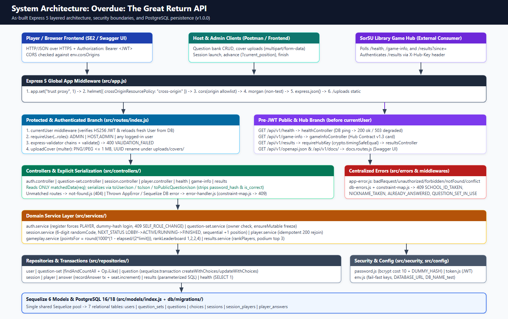
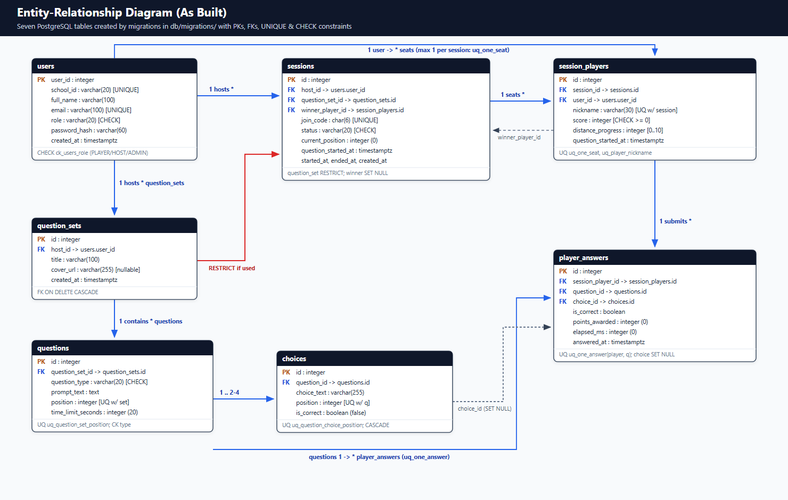

# Technical specification: Overdue: The Great Return API

Version `1.0.0`, SE1 final build. Developer: Carl Angelo Orlina (`icedteacrml11`), BSCS 3-2. Group: Solo.

## 1. Purpose and scope

**Overdue: The Great Return** is a competitive multiplayer library trivia race built for the SorSU Bulan Campus Library Game Hub (Hub Contract v1.3). Hosts curate themed question sets (`2` to `4` choices per question with a configurable `5`–`120` second timer), open a lobby with a server-generated six-digit join code (`100000`–`999999`), and control question progression. Players join with a unique nickname per game, answer the active question before time expires to earn speed-scaled points (`0`–`1000`), and advance along a 10-book return track (`distance_progress` `0`–`10`). The Library Game Hub polls `/api/v1/health`, `/api/v1/game-info`, and authenticated `/api/v1/results` to display finished games, completion flags, and podium rankings.

- **Covered in SE1 (this repository):** Node.js 22+ / Express 5 REST API, PostgreSQL schema via 11 Sequelize migrations and idempotent seeders, JWT + bcrypt authentication with RBAC (`PLAYER`, `HOST`, `ADMIN`), transactional question/answer persistence, safe cover image uploads, Jest + Supertest + Postman test suites, OpenAPI 3 / Swagger UI documentation, and live Render Blueprint deployment (`render.yaml`).
- **Deferred to SE2 (frontend client):** Browser UI (React/Vite game lobby, live trivia canvas, scoreboard views, host editor), WebSocket/polling real-time push enhancements, and persistent cloud object storage for uploaded question-set cover images.

## 2. Architecture

Every HTTP request enters `src/app.js` through global Express middleware (`trust proxy`, `helmet` with cross-origin resource policy, origin-allowlisted `cors`, request logging in non-test environments via `morgan`, and JSON parsing via `express.json()`), with static cover images served under `/uploads`. Under `/api/v1` (`src/routes/index.js`), public Hub Contract endpoints (`/health`, `/game-info`, `/results` guarded by `X-Hub-Key`) and API documentation routes (`/openapi.json`, `/docs/`) mount **before** `currentUser`, so anonymous/Hub callers do not trigger JWT lookup. All module routes (`/auth`, `/users`, `/question-sets`, `/sessions`) run `currentUser` (which parses `Authorization: Bearer <token>` and reloads the fresh account row from PostgreSQL), followed by route-level `requireUser(...)` role guards, `express-validator` chains + `validate`, controller serialization, service business rules, repository SQL/ORM queries, and finally `notFound` and centralized `errorHandler`.

| Layer | Folder | Responsibility | Never |
|---|---|---|---|
| Routes | `src/routes` | Map HTTP verbs/paths to `requireUser(...)`, validator arrays, `validate`, upload middleware, and controller handlers. | Write business rules, database queries, or inline response JSON formatting. |
| Validators | `src/validators` | Validate and sanitize params/query/body inputs with `express-validator` (lengths, regex patterns, allow-listed sort columns, single correct choice). | Query PostgreSQL directly or trust unvalidated `req.body` fields. |
| Controllers | `src/controllers` | Read only `matchedData(req)`, invoke the service layer, and map domain objects through explicit `toJson` serializers with exact status codes. | Import Sequelize models, run SQL, or leak sensitive columns (`password_hash`, `is_correct`). |
| Services | `src/services` | Enforce domain rules (timing/scoring in `pointsFor`, ownership checks, frozen sets, state transitions, tie-aware competition ranks, constant-time login). | Read HTTP `req`/`res` objects or build raw SQL strings directly. |
| Repositories | `src/repositories` | Encapsulate Sequelize ORM queries, eager loading (`include`), atomic `increment()` updates, `sequelize.transaction(...)` blocks, and parameterized Hub SQL. | Enforce HTTP status codes, sign JWTs, or call controllers. |
| Models | `src/models` | Define Sequelize table mappings, `defaultScope` (excluding `password_hash`), scopes, and model associations using a single shared pool. | Define validation rules that replace migrations or open a second `Sequelize` instance. |

## 3. Data

The database consists of **7 relational tables** managed strictly through migrations (`db/migrations/`), with full column definitions and constraints documented in [data-dictionary.md](data-dictionary.md).

PostgreSQL enforces critical integrity invariants independently of application code, and `src/errors/db-errors.js` + `src/errors/constraint-map.js` translate constraint violations into uniform client-safe HTTP `409` responses:

| Table | Database Constraint | Enforced Rule | API Error Translation (`constraint-map.js`) |
|---|---|---|---|
| `users` | `users_school_id_key` (`UNIQUE`) | One account per institutional school ID (`YYYY-NNNN`). | `409 SCHOOL_ID_TAKEN` |
| `users` | `users_email_key` (`UNIQUE`) | One account per lowercase email address. | `409 EMAIL_TAKEN` |
| `users` | `ck_users_role` (`CHECK`) | Role must be `PLAYER`, `HOST`, or `ADMIN`. | Enforced before insert + DB guard |
| `questions` | `uq_question_set_position` (`UNIQUE`) | Distinct `(question_set_id, position)` per question. | Prevents duplicate slot numbering |
| `questions` | `ck_questions_type` (`CHECK`) | Question type must be `MULTIPLE_CHOICE` or `TRUE_FALSE`. | Validated in `question-set.validator.js` |
| `choices` | `uq_question_choice_position` (`UNIQUE`) | Distinct `(question_id, position)` per choice. | Prevents duplicate choice ordering |
| `sessions` | `sessions_join_code_key` (`UNIQUE`) | Globally unique 6-digit `join_code` (`100000`–`999999`). | Retried up to 5 times in `session.service.js`; fallback `409 JOIN_CODE_TAKEN` |
| `sessions` | `sessions_question_set_id_fkey` (`FK RESTRICT`) | Blocks deleting a `question_set` referenced by any game. | `409 QUESTION_SET_IN_USE` |
| `sessions` | `ck_sessions_status` (`CHECK`) | Session status must be `LOBBY`, `ACTIVE`, `RUNNING`, or `FINISHED`. | Validated by `NEXT_STATUS` transition map |
| `session_players` | `uq_one_seat` (`UNIQUE`) | At most one seat per `(session_id, user_id)`. | Caught in `player.service.js` for idempotent `200` rejoin; fallback `409 ALREADY_JOINED` |
| `session_players` | `uq_player_nickname` (`UNIQUE`) | Nicknames must be unique per session `(session_id, nickname)`. | `409 NICKNAME_TAKEN` |
| `session_players` | `ck_score_non_negative`, `ck_distance_progress_range` (`CHECK`) | `score >= 0` and `0 <= distance_progress <= 10`. | Guarantees non-negative totals and valid track bounds |
| `player_answers` | `uq_one_answer` (`UNIQUE`) | One answer per `(session_player_id, question_id)`. | `409 ALREADY_ANSWERED` |

## 4. Security

| Concern | Decision |
|---|---|
| Passwords | Hashed with `bcryptjs` (`cost = 10`, `8`–`72` chars with letter + number). `User.defaultScope` excludes `password_hash`, and login checks `password.matches(plain, hash)` against a precomputed `DUMMY_HASH` when an ID does not exist so unknown IDs and wrong passwords fail in constant time with identical `401 INVALID_CREDENTIALS`. |
| Login and tokens | Signed HS256 JWTs (`jsonwebtoken`, default `8h` / `1h` via `JWT_EXPIRES_IN`) carry `sub` (user ID) and role, sent as `Authorization: Bearer <token>`. On every request, `currentUser` verifies signature + expiration and reloads the account from PostgreSQL (`INVALID_TOKEN` if deleted or invalid). |
| Roles | Strict RBAC enforced before input validation: `requireUser('HOST', 'ADMIN')` on question sets and session creation/control, `requireUser('ADMIN')` on `/users`, and `requireUser()` on joining/answering. `POST /auth/register` ignores any client-supplied `role` and forces `PLAYER`; admins cannot demote/change themselves (`409 SELF_ROLE_CHANGE`). |
| Input | Every route uses `express-validator` + `matchedData(req)` allow-listing; `?sort=` is checked against an explicit allow-list (`id`, `title`, `created_at`) rather than interpolated into SQL; search terms (`?q=`) use parameterized `Op.iLike`; cover uploads (`multer`) allow only `image/png` or `image/jpeg`, `<= 1 MB`, and rename files with `crypto.randomUUID()`. |
| Your game's trust boundary | The server generates 6-digit `join_code`s, assigns question/choice `position`s, sets `host_id` from `req.user.user_id`, strips `is_correct` from `GET /sessions/:code/question`, records `session.question_started_at`, computes `elapsed_ms` and `pointsFor(...)` server-side, freezes used question sets (`409 QUESTION_SET_IN_USE`), and updates scores atomically inside a transaction (`seat.increment`). |
| Browsers (CORS) | `helmet` sets defensive HTTP headers (`crossOriginResourcePolicy: 'cross-origin'` so `/uploads` assets can load in a separate frontend origin), and `cors` reflects `Access-Control-Allow-Origin` **only** when the request origin is listed in `CORS_ORIGINS` (never `*`). |
| The Hub | `/api/v1/results` requires `X-Hub-Key` validated against `env.hubApiKey` with constant-time `crypto.timingSafeEqual` (`requireHubKey`), answering `401 HUB_KEY_REQUIRED` if missing or invalid. |

## 5. Quality

- **Automated Jest Suite (`npm run test:coverage`):** **33 passing tests across 9 test files** (`4` unit test suites in `tests/unit/` using `jest.mock(...)` to test `results.service`, `gameplay.service`, `auth.service`, and `question-set.service` in isolation; `5` Supertest HTTP integration suites in `tests/api/` running against an auto-rebuilt `<DB_NAME>_test` database), covering **92.03%** of lines in `src/`.
- **Postman / Newman End-to-End Suite:** **79 requests and 79 assertions (`0` failed)** rebuilt from scratch (`npm run db:reset`), exercising authentication, question-bank pagination/uploads/freezing, full multi-player gameplay, and Hub `/results` verification.
- **Automated Grader Check (`npm run check`):** All Week 15 criteria `A`–`N` pass (`51 passed, 0 failed`), verifying clean secrets hygiene, reversible migrations, idempotent seeds, OpenAPI `3.0.3` / Swagger UI (`26` operations), CORS enforcement, and live Render `/health` + `/game-info` verification prior to running Week 16 Criterion `O`.

## 6. Deployment

- **Platform & Blueprint:** Deployed on Render (Singapore region) from [render.yaml](../render.yaml), provisioning web service `overdue-the-great-return-orlina` (Node 22+, free plan) and PostgreSQL 18 database `overdue-the-great-return-orlina-db`.
- **Live Base URL:** `https://overdue-the-great-return-orlina.onrender.com/api/v1` (Swagger UI at `/docs/`, spec at `/openapi.json`).
- **Start Command (`npm run start:render`):** Runs `sequelize-cli db:migrate && node scripts/create-admin.js && node src/server.js`. Seeders are intentionally excluded in production so demo credentials are never created on the public server; `ADMIN_SCHOOL_ID` and `ADMIN_PASSWORD` create the sole bootstrap `ADMIN`.
- **Free-Tier Limits:** Service sleeps after 15 minutes without HTTP traffic (~60s cold start), ephemeral filesystem deletes uploaded `/uploads/covers/*` files on redeploy/restart, and the free Render PostgreSQL database expires 30 days after creation (`Nov 14, 2026` → `Dec 14, 2026`).

## 7. Decisions and their reasons

| Decision | Reason | Alternative not taken | Cost / Trade-off accepted |
|---|---|---|---|
| Freeze a question set (`409 QUESTION_SET_IN_USE`) and set `FK ON DELETE RESTRICT` once referenced by any session | Preserves historical accuracy of past games, leaderboards, and Library Hub `/results` telemetry. | Soft-delete or allow in-place question edits after games were already played. | Hosts cannot edit/delete a set after running even a test session; they must create a new set instead. |
| Bundle question advancement into `PATCH /sessions/:code` (`{ current_position }`) instead of adding a separate `/next` POST endpoint | Keeps all host session-state transitions (`LOBBY` → `RUNNING` → question N → `FINISHED`) RESTful on one resource. | Adding a separate `POST /sessions/:code/next` action endpoint. | Clients cannot simultaneously send `status` and `current_position` semantics arbitrarily; progression strictly increments `+1` at a time. |
| Move `sequelize-cli` from `devDependencies` into `dependencies` | Render runs `npm ci` with `NODE_ENV=production`, which skips `devDependencies`, causing `start:render` migrations to fail (`sequelize-cli: not found`). | Writing a custom programmatic Umzug runner or installing dev dependencies in production builds. | Slightly larger production `node_modules` footprint in exchange for zero-config CLI migrations on Render. |
| Store session progress only in PostgreSQL and keep SE1 endpoints purely HTTP request/response (`GET /question`, `POST /answers`) | Keeps the SE1 backend stateless across restarts, simpler to unit/Supertest-test, and strictly compliant with Hub Contract REST guidelines. | Adding Socket.IO real-time timers and push broadcasts in SE1. | SE2 frontend must poll `GET /sessions/:code/question` and `/leaderboard` until WebSockets are added if needed later. |
| Compare unknown accounts against a dummy bcrypt hash (`DUMMY_HASH`) in `auth.service.login` | Prevents user-enumeration timing attacks as well as response-body leaks (`401 INVALID_CREDENTIALS` for both cases). | Returning immediately when `userRepository.findForLogin` returns `null`. | Adds ~100ms of intentional CPU work per invalid school-ID login attempt. |
| Compute `elapsed_ms` on the server from `session.question_started_at` and update player scores with `seat.increment(...)` inside a DB transaction | Prevents clients from forging fast answer times or dropping points under concurrent answer submissions. | Trusting client-supplied timestamps or doing non-transactional JavaScript read-modify-write score updates. | Does not subtract network round-trip latency from player response time (~50–200ms). |
